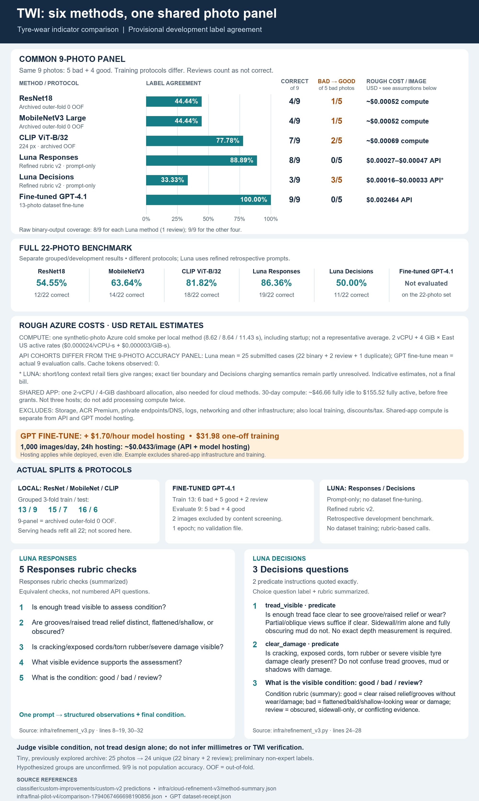

# Tyre Wear Indicator — six-method research pilot

A reproducible source export for a small visual-condition experiment: good, bad or review from a photo. This is preliminary label agreement, not measured tread depth, verified TWI detection, roadworthiness certification or demonstrated population safety. The source archive has been repeatedly explored; even 9/9 is not proof of 100% real-world accuracy.

## Methods and results

| Method | All 22 binary photos | Same nine development photos | Bad called good: all22 / same9 | Status at 9 November 2026 |
|---|---|---|---|---|
| [ResNet18](methods/resnet18/README.md) | 12/22 | 4/9 | 2/13 / 1/5 | Implemented live upload, frozen features + head |
| [MobileNetV3-Large](methods/mobilenet/README.md) | 14/22 | 4/9 | 3/13 / 1/5 | Implemented live upload, frozen features + head |
| [CLIP ViT-B/32](methods/clip/README.md) | 18/22 | 7/9 | 2/13 / 2/5 | Implemented live upload, frozen image features + head |
| [Luna Responses v2](methods/luna-responses/README.md) | 19/22 | 8/9 | 1/13 / 0/5 | Benchmark-only, genuine API experiment |
| [Luna Decisions v2](methods/luna-decisions/README.md) | 11/22 | 3/9 | 6/13 / 3/5 | Benchmark-only, genuine typed-question experiment |
| [GPT-4.1 vision fine-tuned](methods/gpt41-finetuned/README.md) | Not evaluated | 9/9 | Not evaluated / 0/5 | Completed SFT; implemented live upload |
| [Azure AutoML](methods/azure-automl/README.md) | Unrun | Unrun | Unknown | Prepared, GPU quota blocked; not a seventh scored result |

Untuned GPT-4.1 baseline: 8/9, no 22-photo score. Binary coverage is 22/22 for local forced-binary diagnostics, 20/22 for each Luna v2 (8/9 on the shared subset), and 9/9 for GPT; accepted accuracy and abstentions are separate in [safe metrics](results/method-summary.json). Operational automatic safety approval remains zero: diagnostic good does not authorize road use.

## Dataset and splits

25 original photos, one exact duplicate, 24 unique photos, 22 binary photos (13 bad, 9 good), two review examples. Conservative visual-similarity groups are hypotheses, not confirmed tyre/session IDs. The duplicate stays out of local training/scoring; review examples stay out of binary head training.

Local grouped outer train/test counts: 13/9, 15/7, 16/6. Grouped inner two-fold searches only use outer-training rows. Shared nine = outer fold zero, five bad/four good; it was a development comparison, not an untouched prospective test. The final serving heads were refitted on all 22 and are not independently tested by those OOF scores. The fixed CLIP candidate was retrospectively ranked after candidate comparison: its 18/22 is not the nested all-architecture selector's score.

GPT actual uploaded training set: 13 photos, six bad/five good/two review, NOT the earlier planned 15. Two planned inputs were excluded by person-content screening. Evaluation: the same separate nine. One epoch, effective batch size one, learning-rate multiplier two, seed105. AutoML prepared 10 train/3 validation/9 evaluation (review examples excluded, GPT-specific screening not reused).

[Partitions](results/partitions.json) · [Per-image anonymous results](results/per-image.json) · [CSV](results/per-image.csv) · [All experimental rounds](docs/EXPERIMENTS.md)

## Reproduce without cloud calls

Python on Linux/WSL is the supported local research path. Dependencies are archived exact environment pins, not a promise that future package repositories retain every build. Install base requirements using the CPU wheel index; CLIP/DINO require the foundation additions. A full modern ca2 production deployment is deliberately not recreated by this export.

```sh
python3 -m venv .venv
.venv/bin/python -m pip install -r requirements-pilot-lock.txt --extra-index-url https://download.pytorch.org/whl/cpu
.venv/bin/python -m pip install -r requirements-foundation-lock.txt --extra-index-url https://download.pytorch.org/whl/cpu
.venv/bin/python tools/check_publication.py
.venv/bin/python tools/run_offline_tests.py
```

The first checker uses only stdlib; offline tests use already installed source dependencies and synthetic storage/security fixtures, never substitute fake predictions for missing model evidence. See [verification scope](docs/VERIFICATION.md). Tests needing withheld provider/dataset evidence skip with a reason; no private-photo inference, pretrained download, training, cloud API or deployment occurs during publication checks.

For full local reproduction, acquire the owner's authorized original archive privately and follow [data acquisition](docs/DATA_EXCLUDED.md). Then run the actual source scripts in order (audit, canonicalization/ResNet, MobileNet comparison, CLIP/DINO comparison); method READMEs give commands and real expected artifact names. Downloaded public checkpoints and locally regenerated trusted heads remain ignored, never Git LFS uploads.

## Runtime and hosting

Public password-gated pilot URL at the dated snapshot: https://ca-tyre-dashboard-v7-internal.wonderfuldune-a54fb433.eastus.azurecontainerapps.io . Four upload methods were available (ResNet, MobileNet, CLIP, GPTFT); Luna methods remain documented benchmark experiments, not removed or falsely live. Removing availability badges from the infographic was presentation-only.

The local exported app runs with `python -m app.server --bind 127.0.0.1 --port 8765`; missing heads/cloud receipts correctly show unavailable. It is real application code, not cached benchmark predictions presented as live inference. This curated source variant is NOT the deployed image or its complete private native receipt/ledger/runtime package. [Runtime boundaries](docs/RUNTIME.md) describe the differences and configuration requirements. No auto-deployment workflows are installed.

Dated paid-call snapshot: 190/200 lifetime inference attempts as of public acceptance on9November2026. This is history, NOT the export's spend allowance or a current production readback. No production ledger, IAM receipt, password enrollment verifier or private capability is included.

## Costs, provenance and limitations

[Indicative Azure costs](docs/COSTS.md) separate API tokens, marginal processing, shared hosting and fixed fine-tuned-model hosting. Locals are not free to host. [Copy-ready team summary](docs/assets/team-summary-with-costs.txt), [PNG](docs/assets/twi-six-methods-costs.png) and [editable SVG](docs/assets/twi-six-methods-costs.svg) preserve current Luna questions; no Human Review section is added to that visual. Scientific limitations remain in the documentation.



[Security and private data](SECURITY.md) · [Export/source mapping](export-manifest.json) · [Third-party notices](THIRD_PARTY_NOTICES.md) · [Excluded assets](docs/DATA_EXCLUDED.md). Private repository visibility is not permission to upload customer/person images. No project-wide license grant over source, customer data or third-party weights is invented; publication/access rights require owner and upstream review.
